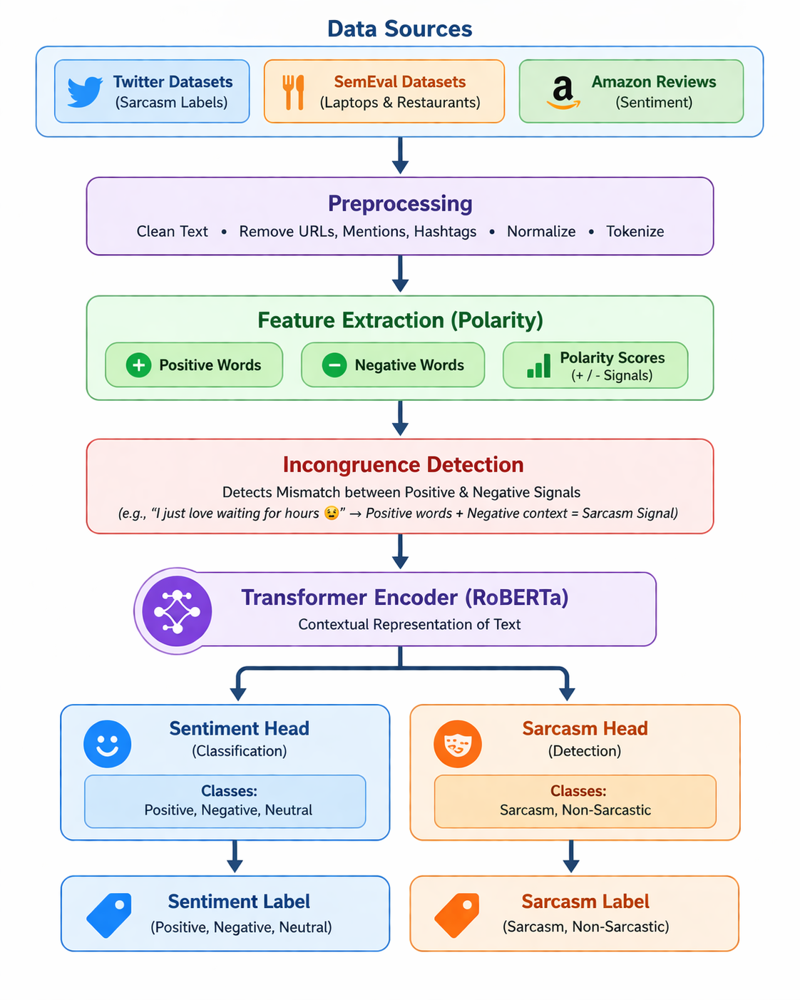
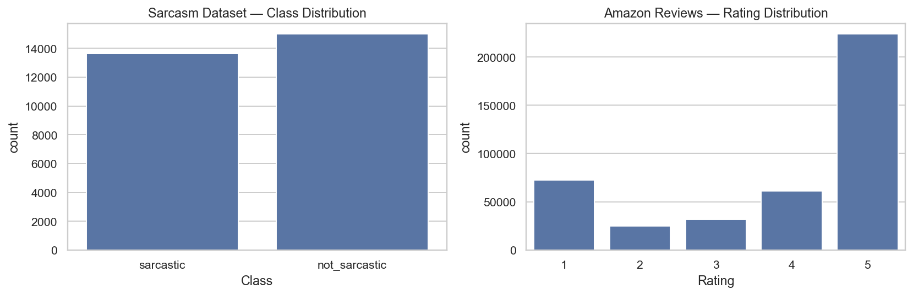

# 🎭 Sarcasm Detection as Sentiment Incongruence using RoBERTa

[](https://www.python.org/)
[](https://pytorch.org/)
[](https://huggingface.co/)
[](https://huggingface.co/roberta-base)
[](LICENSE)
[]()

> **MCA AI/ML NLP Project**: Investigating sarcasm detection through contextual sentiment incongruence by benchmarking traditional baselines (**TF-IDF + Logistic Regression**) against deep bidirectional transformer encoders (**Fine-Tuned RoBERTa-base**).

---

## 📑 Table of Contents
- [📌 Project Overview](#-project-overview)
- [🏗️ System Architecture](#️-system-architecture)
- [💡 Concept: Sentiment Incongruence](#-concept-sentiment-incongruence)
- [📊 Experimental Results & Benchmarks](#-experimental-results--benchmarks)
- [🖼️ Visual Outputs & Model Evaluation](#️-visual-outputs--model-evaluation)
- [📁 Repository Structure](#-repository-structure)
- [⚙️ Datasets Used](#️-datasets-used)
- [🚀 Quickstart & Setup](#-quickstart--setup)
- [📑 Technical Report](#-technical-report)
- [👤 Author & Acknowledgments](#-author--acknowledgments)

---

## 📌 Project Overview

Sarcasm is one of the most notoriously difficult challenges in Natural Language Processing (NLP) because the intended figurative meaning often sharply contradicts the literal surface words. Traditional Bag-of-Words and N-gram approaches fail when surface sentiment is overwhelmingly positive while the pragmatic context is negative.

### Core Objectives:
1. **Contextual Representations**: Fine-tune a `roberta-base` transformer to capture long-range semantic dependencies and nuanced linguistic cues.
2. **Sentiment Incongruence Analysis**: Formulate and evaluate sarcasm through the lens of emotional and sentiment mismatch (e.g., highly positive phrasing paired with negative context).
3. **Comparative Evaluation**: Rigorously benchmark RoBERTa against a standard baseline (**TF-IDF Vectorizer + Logistic Regression**) across multiple classification metrics.
4. **Cross-Domain Qualitative Validation**: Analyze model generalization using user reviews from the Amazon Unlocked Mobile dataset.

---

## 🏗️ System Architecture

The following diagram illustrates the complete end-to-end experimental workflow, from raw text ingestion, multi-stage preprocessing, tokenization, model fine-tuning, to evaluation and interpretability analysis:

<p align="center">
  
</p>

---

## 💡 Concept: Sentiment Incongruence

Why does sentiment incongruence indicate sarcasm?
- **Surface Utterance**: *"I absolutely love waiting 3 hours at the airport customer support desk."*
- **Surface Polarity**: **Positive** (*"love"*, *"support"*)
- **Contextual Reality**: **Negative** (*"waiting 3 hours"*, delay frustration)
- **Signal**: The divergence between the lexical sentiment score and the underlying situational context serves as a strong indicator of sarcastic intent.

<p align="center">
  
</p>

---

## 📊 Experimental Results & Benchmarks

The models were evaluated on the held-out test split of the News Headlines Sarcasm Dataset. RoBERTa significantly outperforms the classical baseline across all metrics:

| Model Architecture | Accuracy | Precision | Recall | Macro F1 | ROC-AUC |
| :--- | :---: | :---: | :---: | :---: | :---: |
| **TF-IDF + Logistic Regression (Baseline)** | 77.13% | 77.40% | 77.35% | 0.7713 | 0.8581 |
| **RoBERTa-base (Fine-Tuned)** | **81.06%** | **81.15%** | **80.87%** | **0.8094** | **0.8951** |

> **Key Takeaway**: RoBERTa achieved a **+3.93% boost in accuracy**, a **+0.038 gain in Macro F1**, and an outstanding **0.8951 ROC-AUC**, demonstrating the power of deep contextual self-attention over static n-gram frequency features.

---

## 🖼️ Visual Outputs & Model Evaluation

### 1. Confusion Matrix & ROC Curve Comparison
The confusion matrix shows balanced true-positive (1,567) and true-negative (1,899) classification, while the ROC curve demonstrates RoBERTa's superior discrimination capability across all classification thresholds:

| Confusion Matrix (RoBERTa) | ROC-AUC Curve (Baseline vs RoBERTa) |
| :---: | :---: |
|  |  |

### 2. Dataset Distributions & Training Dynamics
Class balance inspection of the News Headlines dataset alongside the star rating distribution of the auxiliary Amazon Reviews dataset, plus RoBERTa's training convergence:

| Dataset Distributions | RoBERTa Training Loss Curve |
| :---: | :---: |
|  |  |

---

## 📁 Repository Structure

```plaintext
sarcasm-detection-roberta/
│
├── Detecting_Sarcasm_as_Sentiment_Incongruence_UPDATED.ipynb   # Main Jupyter Notebook (Full Pipeline)
├── Sarcasm_Headlines_Dataset_v2.json                           # Annotated News Headlines Dataset
├── Sarcasm_Detection_Using_RoBERTa_Technical_Report.pdf        # Complete Academic/Technical Report
├── Sarcasm_Detection_Using_RoBERTa_Technical_Report.docx       # Editable Technical Report
│
├── real.png                                                     # Complete End-to-End System Architecture
├── pipeline.png                                                 # Polarity & Incongruence Pipeline
├── Arch.png                                                     # High-Level Architecture Overview
│
├── sarcasm_outputs/                                             # Generated Output Artifacts & Plots
│   ├── confusion_matrix.png                                     # RoBERTa Confusion Matrix
│   ├── roc_curve.png                                            # ROC Curves (TF-IDF vs RoBERTa)
│   ├── training_curve.png                                       # RoBERTa Fine-Tuning Loss
│   ├── dataset_distributions.png                                # Class & Review Distributions
│   ├── class_distribution.png                                   # Sarcasm Class Distribution
│   ├── amazon_rating_distribution.png                           # Amazon Rating Histogram
│   └── model_comparison.csv                                     # Numerical Metrics Summary
│
├── .gitignore                                                   # Git exclusion rules (weights & large data)
└── README.md                                                    # Project Documentation & Showcase
```

---

## ⚙️ Datasets Used

1. **News Headlines Dataset for Sarcasm Detection (v2)**:
   - Contains **28,619** news headlines sourced from *The Onion* (sarcastic) and *HuffPost* (non-sarcastic).
   - High-quality human-annotated binary ground truth (`is_sarcastic: 0 or 1`).
   - Included directly in the repository: [`Sarcasm_Headlines_Dataset_v2.json`](Sarcasm_Headlines_Dataset_v2.json).

2. **Amazon Unlocked Mobile Reviews**:
   - Over 400,000 consumer electronics product reviews.
   - Used for auxiliary rating-derived sentiment polarity (1–2 stars = Negative, 3 stars = Neutral, 4–5 stars = Positive) to evaluate contextual incongruence on external domains.
   - *Note: Due to GitHub's 100MB file limit, this large dataset (`Amazon_Unlocked_Mobile.csv`) is excluded from git tracking. Download it from Kaggle if reproducing auxiliary experiments.*

---

## 🚀 Quickstart & Setup

### 1. Clone the Repository
```bash
git clone https://github.com/RushilSatwara32/sarcasm-detection-roberta.git
cd sarcasm-detection-roberta
```

### 2. Create and Activate Virtual Environment
```bash
# Windows
python -m venv venv
venv\Scripts\activate

# macOS / Linux
python3 -m venv venv
source venv/bin/activate
```

### 3. Install Dependencies
```bash
pip install torch transformers datasets scikit-learn pandas numpy matplotlib seaborn tqdm
```

### 4. Run the Pipeline
Launch Jupyter Notebook or Jupyter Lab:
```bash
jupyter notebook Detecting_Sarcasm_as_Sentiment_Incongruence_UPDATED.ipynb
```
> **Tip**: Set `FAST_MODE = True` in the notebook configuration cell to run rapid inference or verification, or set `FAST_MODE = False` to execute the full fine-tuning run.

---

## 📑 Technical Report

A detailed research paper and technical project report is included in this repository:
- 📄 **PDF Report**: [Sarcasm_Detection_Using_RoBERTa_Technical_Report.pdf](Sarcasm_Detection_Using_RoBERTa_Technical_Report.pdf)
- 📝 **Word Document**: [Sarcasm_Detection_Using_RoBERTa_Technical_Report.docx](Sarcasm_Detection_Using_RoBERTa_Technical_Report.docx)

Topics covered in the report:
- Theoretical foundation of bidirectional self-attention mechanisms in RoBERTa.
- Mathematical formulation of Sentiment Incongruence.
- Error analysis on False Positives and False Negatives.
- Domain transfer limitations and future directions.

---

## 👤 Author & Acknowledgments

- **Author**: Rushil Satwara
- **Academic Context**: MCA AI/ML — Natural Language Processing (NLP)
- **Hugging Face**: Built using [`roberta-base`](https://huggingface.co/roberta-base) by Facebook AI.
- **Dataset Credits**: Rishabh Misra (*News Headlines Dataset for Sarcasm Detection*).

---

## 📜 License
This project is licensed under the [MIT License](LICENSE). Feel free to star ⭐ the repository if you find this helpful!
