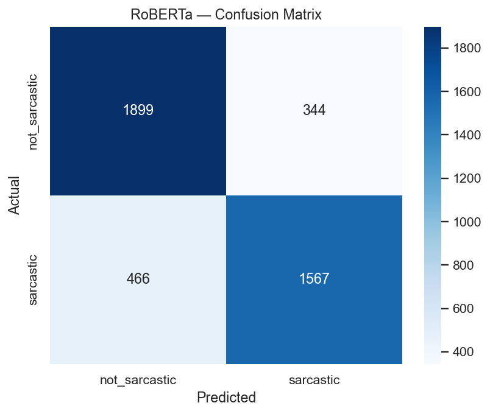
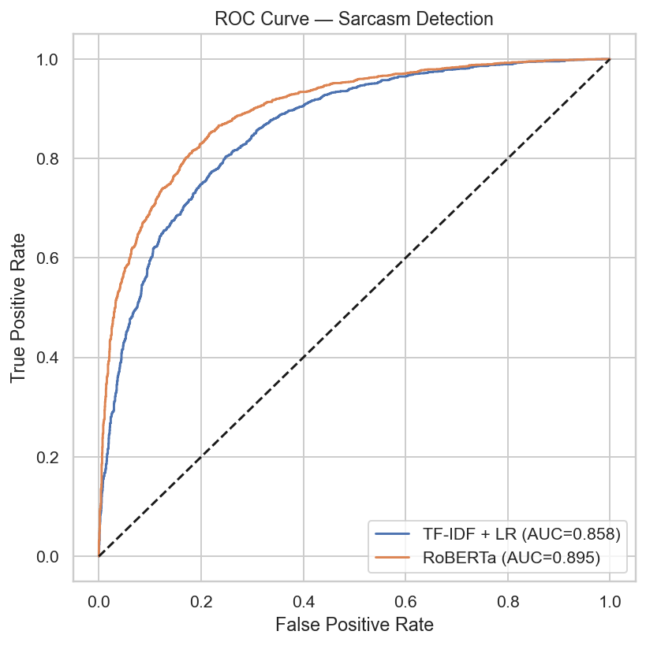
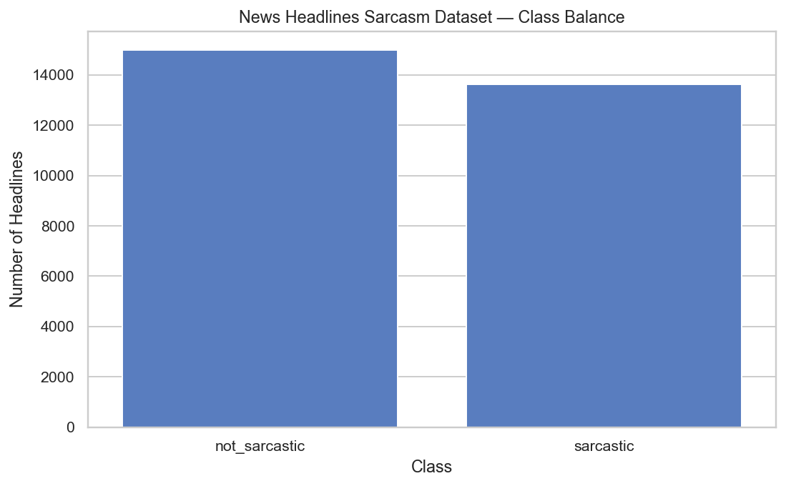
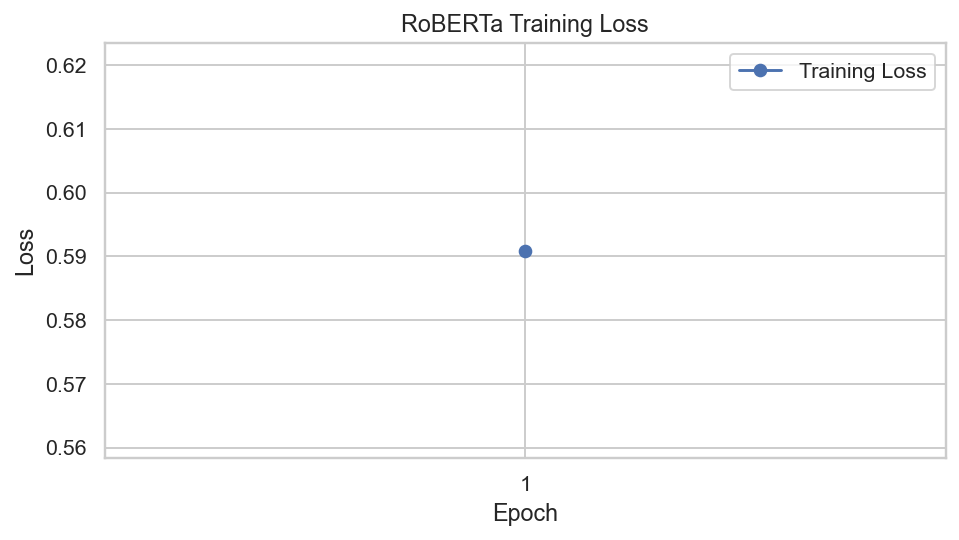
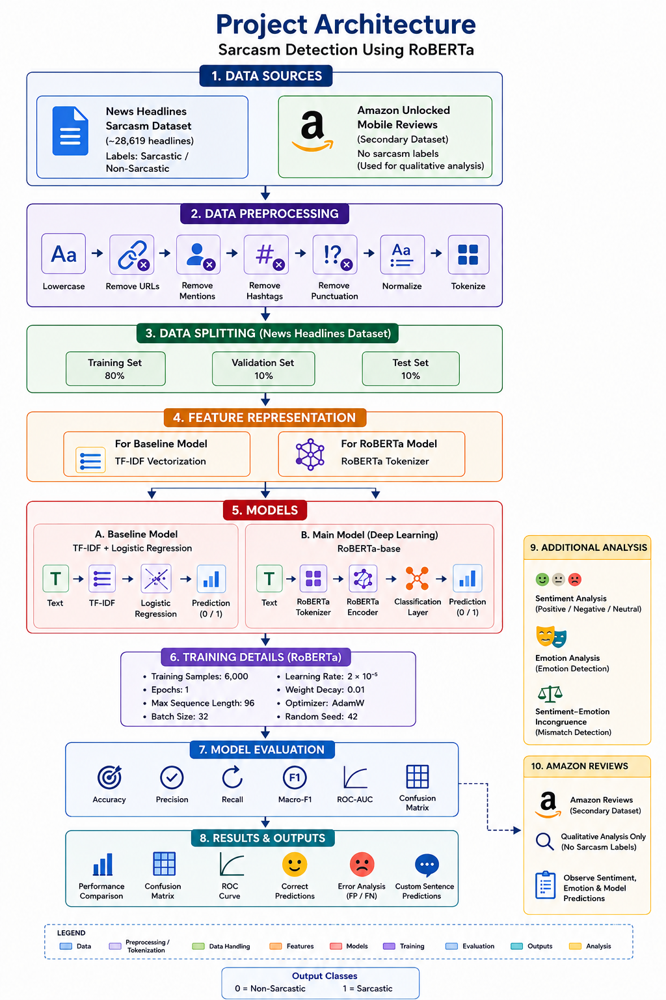

<div align="center">

# Sarcasm Detection in News Headlines Using RoBERTa

### A comparison of a contextual transformer model with a TF-IDF baseline

[](https://www.python.org/)
[](https://jupyter.org/)
[](https://huggingface.co/docs/transformers)
[](https://scikit-learn.org/)
[](LICENSE)

**Research project:** Does contextual language understanding improve sarcasm detection compared with a traditional text-classification baseline?

[Repository](https://github.com/rushilsatwara73/sarcasm-detection-roberta) · [Report](Sarcasm_Detection_Using_RoBERTa_Technical_Report.pdf) · [Notebook](Detecting_Sarcasm_as_Sentiment_Incongruence_UPDATED.ipynb)

</div>

---

## Overview

Sarcasm is difficult for a classifier because a headline's literal words do not always express the speaker's intended meaning. This project compares two approaches for classifying news headlines as **sarcastic** or **not sarcastic**:

1. **TF-IDF + Logistic Regression** — a lightweight baseline that learns from word-weighted text features.
2. **RoBERTa-base** — a pretrained transformer fine-tuned for the classification task, designed to represent words in context.

The project evaluates both models on held-out data and examines common prediction errors. A separate Amazon mobile-review dataset is used only for exploratory sentiment-related analysis; it has no sarcasm ground-truth labels and is **not** used to claim measured sarcasm-classification performance.

## Main results

The table below reproduces the values reported in the project's current report/README. **Please verify the final values against one consistent run and the saved `model_comparison.csv` before using them as final research results.**

| Model | Accuracy | Precision | Recall | Macro-F1 | ROC-AUC |
|---|---:|---:|---:|---:|---:|
| TF-IDF + Logistic Regression | 77.13% | 77.40% | 77.35% | 0.7713 | 0.8581 |
| RoBERTa-base (fine-tuned) | 81.06% | 81.15% | 80.87% | 0.8094 | 0.8951 |

**Reported finding:** RoBERTa has a higher reported accuracy and ROC-AUC than the TF-IDF baseline. This should be treated as the project's reported result, not a guarantee that every run will reproduce exactly the same values.

### Evaluation visualizations

The following images are saved in the repository's `sarcasm_outputs/` directory.

<table>
<tr>
<td align="center" width="50%">

**Confusion matrix**

<br>



</td>
<td align="center" width="50%">

**ROC curve**

<br>



</td>
</tr>
<tr>
<td align="center" width="50%">

**Headline class distribution**

<br>



</td>
<td align="center" width="50%">

**Training loss**

<br>



</td>
</tr>
</table>

## Methodology

```text
News Headlines Sarcasm Dataset
            |
            v
Text cleaning and stratified data split
            |
            +----------------------------+
            |                            |
            v                            v
      TF-IDF vectors                RoBERTa tokenizer
            |                            |
            v                            v
 Logistic Regression              RoBERTa-base
            |                     fine-tuning
            +-------------+--------------+
                          |
                          v
       Held-out evaluation and error analysis
                          |
                          v
 Accuracy | Precision | Recall | Macro-F1 | ROC-AUC
```

### Models

- **Baseline:** TF-IDF converts text into weighted word features; Logistic Regression predicts one of the two classes.
- **Main model:** RoBERTa uses contextual token representations and a classification head to predict the sarcasm label.
- **Evaluation:** Both approaches are compared with classification metrics and ROC-AUC. A confusion matrix is used to inspect true and incorrect predictions.

### Dataset

- **Primary dataset:** News Headlines Sarcasm Dataset v2, reported as approximately 28,619 headline records with a binary sarcasm label.
- **Secondary dataset:** Amazon Unlocked Mobile Reviews, used for exploratory sentiment-related observations only. It does not contain sarcasm labels, so accuracy, precision, recall, and F1 for sarcasm are not calculated on it.

Check the dataset's original terms and source before redistributing it. If the Amazon CSV is too large or has separate distribution terms, provide instructions for downloading it rather than committing the full file.

## Repository contents

A typical project layout is:

```text
.
├── README.md
├── Detecting_Sarcasm_as_Sentiment_Incongruence_UPDATED.ipynb
├── Sarcasm_Headlines_Dataset_v2.json
├── Sarcasm_Detection_Using_RoBERTa_Technical_Report.pdf
├── Sarcasm_Detection_Using_RoBERTa_Technical_Report.docx
├── Arch.png
├── pipeline.png
├── real.png
└── sarcasm_outputs/
    ├── confusion_matrix.png
    ├── roc_curve.png
    ├── training_curve.png
    └── model_comparison.csv
```

File names and folders may differ slightly depending on the version you upload. Keep the README consistent with the actual repository contents.

## Run locally

### 1. Clone the repository

```bash
git clone https://github.com/rushilsatwara73/sarcasm-detection-roberta.git
cd sarcasm-detection-roberta
```

### 2. Create and activate a virtual environment (recommended)

```bash
python -m venv .venv
```

Windows PowerShell:

```powershell
.venv\Scripts\Activate.ps1
```

macOS/Linux:

```bash
source .venv/bin/activate
```

### 3. Install dependencies

```bash
pip install torch transformers datasets scikit-learn pandas numpy matplotlib seaborn jupyter
```

If the repository includes a tested `requirements.txt`, prefer:

```bash
pip install -r requirements.txt
```

### 4. Open the notebook

```bash
jupyter notebook
```

Open `Detecting_Sarcasm_as_Sentiment_Incongruence_UPDATED.ipynb`, confirm the dataset path in the notebook, and run the cells in order. Model fine-tuning can take substantial time and memory; a GPU-enabled environment such as Google Colab may be helpful.

## Example prediction

The notebook's `real.png` image is intended to show a sample inference. Use it as an example of model behavior, not as a proof of overall performance. Model quality should be assessed on the held-out test set using the reported metrics.



## Limitations

- Sarcasm may depend on external, cultural, conversational, or author-specific context not present in a headline.
- Training on a subset or for only a small number of epochs can limit generalization.
- Results depend on the dataset split, preprocessing, training settings, and model checkpoint.
- Amazon mobile reviews do not contain sarcasm ground-truth labels in this workflow; that analysis is exploratory and should not be presented as a labelled sarcasm benchmark.
- The current project outputs and reported metrics should be regenerated and checked together before making final academic claims.

## Research report

The full technical report is available as [`Sarcasm_Detection_Using_RoBERTa_Technical_Report.pdf`](Sarcasm_Detection_Using_RoBERTa_Technical_Report.pdf), if that file is included in the repository.

## AI-tool acknowledgement

Disclose any AI tools used to brainstorm, write, debug, edit, or document this project in accordance with your course policy. Describe the actual use accurately and explain that code and claims were reviewed against the notebook, data, and experiment outputs. Do not claim that model results or references were verified unless you personally checked them.

## License

This repository includes an MIT license file if `LICENSE` is present. Dataset licenses and terms remain separate; review the original dataset sources before redistributing data.

---

<div align="center">

**Built for an academic NLP research project**

</div>
